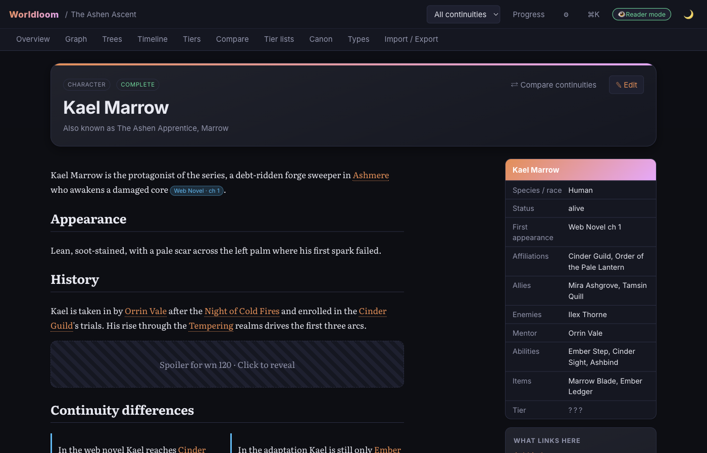
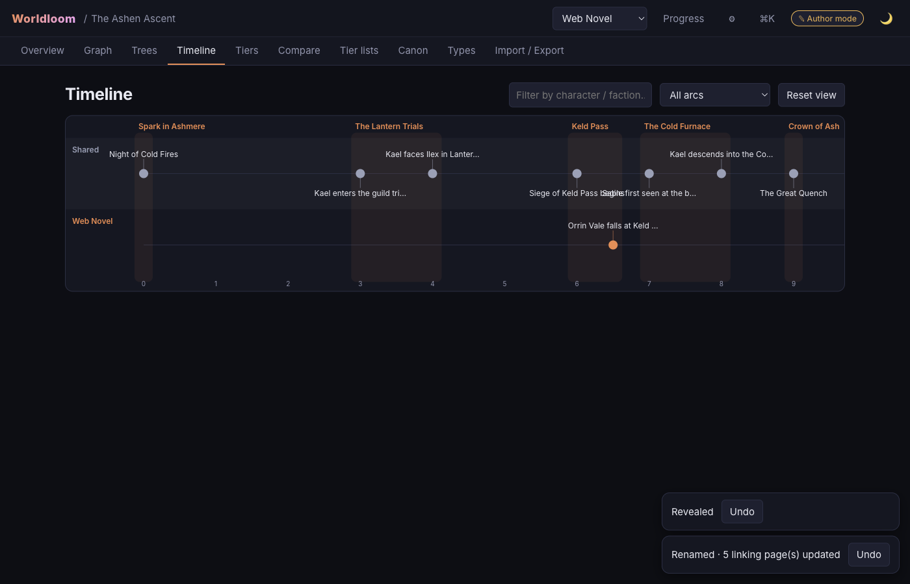
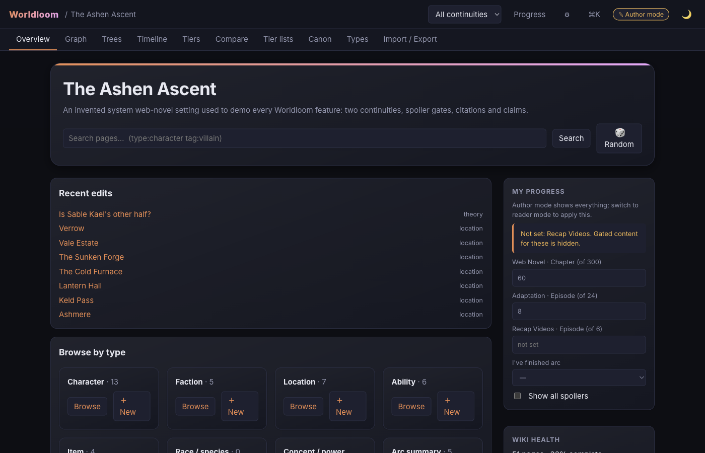
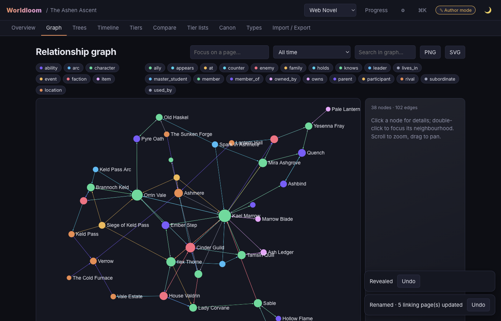

# Worldloom

A local-first desktop wiki builder for deep fictional lore: manhwa / manhua / anime / web & light novels, TTRPG campaigns, your own worlds.

- **Multi-continuity canon** — one page, different truths per continuity (Web Novel vs Anime vs …), with citations and confidence markers.
- **Spoiler protection from your real progress** — gates on pages, blocks, fields, relations, events and tiers; enforced **server-side** everywhere (search, graph, hover cards, exports).
- **Real wiki mechanics** — `[[links]]`, backlinks, aliases/redirects, red links, infoboxes, categories, page history, rename-with-link-rewrite (undoable).
- **Visual lore tools** — relationship graph, hierarchies, parallel-track timeline, power-tier ladders, compare tool, tier-list boards.
- **Private** — no accounts, no telemetry, **zero network calls** (the optional Lorekeeper link is loopback-only and off by default). Worlds are plain Markdown + JSON in your app-data folder, optionally **encrypted** per world.
- **Share & sync without a cloud** — spoiler-safe bundles, three-way merges with conflict pages, shared-folder sync, and a Lorekeeper progress link ([details](docs/PRIVACY_AND_SYNC.md)).

| Reader mode (spoilers hidden) | Timeline (one track per continuity) |
| --- | --- |
|  |  |
|  |  |

*(Screenshots show the bundled, fully invented demo worlds.)*

## Run it

```bash
npm install
npm run dev          # API (127.0.0.1:4777) + web UI (http://localhost:5173); data in ./.dev-data
npm start            # build and launch the Electron app (apps/desktop)
npm test             # unit, API, spoiler-leak and performance suites
npm run e2e          # Playwright against the built Electron app (needs a display; xvfb on Linux)
npm run dist         # installers for the current OS (apps/desktop/release)
```

Requires Node 22. Open a **demo world** from the home screen, or create your own from a template.

## Where is my data?

`%APPDATA%\Worldloom` · `~/Library/Application Support/Worldloom` · `$XDG_CONFIG_HOME|~/.config/Worldloom` — override with `WORLDLOOM_DATA_DIR` or *Settings → Change folder*. See [docs/DATA_FORMAT.md](docs/DATA_FORMAT.md). Hand-edit any `.md`/`.json` while the app runs; it reloads live and never lets a broken edit overwrite memory.

## Docs

[ARCHITECTURE](docs/ARCHITECTURE.md) · [PRIVACY_AND_SYNC](docs/PRIVACY_AND_SYNC.md) · [DATA_FORMAT](docs/DATA_FORMAT.md) · [WIKI_SYNTAX](docs/WIKI_SYNTAX.md) · [SPOILERS](docs/SPOILERS.md) · [SECURITY](docs/SECURITY.md)

## Builds are unsigned

Installers are not notarized yet. The macOS app is **ad-hoc signed** (a build hook does this), so Gatekeeper shows “unidentified developer” instead of “damaged”: right-click the app → Open, or allow it in System Settings → Privacy & Security. If macOS still says the app is damaged (a quarantine flag on a downloaded copy), run `xattr -cr /Applications/Worldloom.app` once. Windows SmartScreen will warn (More info → Run anyway). To add signing later: set `CSC_LINK`/`CSC_KEY_PASSWORD` (+ `APPLE_ID`, `APPLE_APP_SPECIFIC_PASSWORD`, `APPLE_TEAM_ID` for notarization) as GitHub secrets and add a `mac.notarize` block / Windows certificate to the `build` section of `apps/desktop/package.json`; the release workflow already passes them through.

## License / content

Code: MIT. Everything in `starter-worlds/` is original, invented content. Your own worlds live only in your app-data folder.
