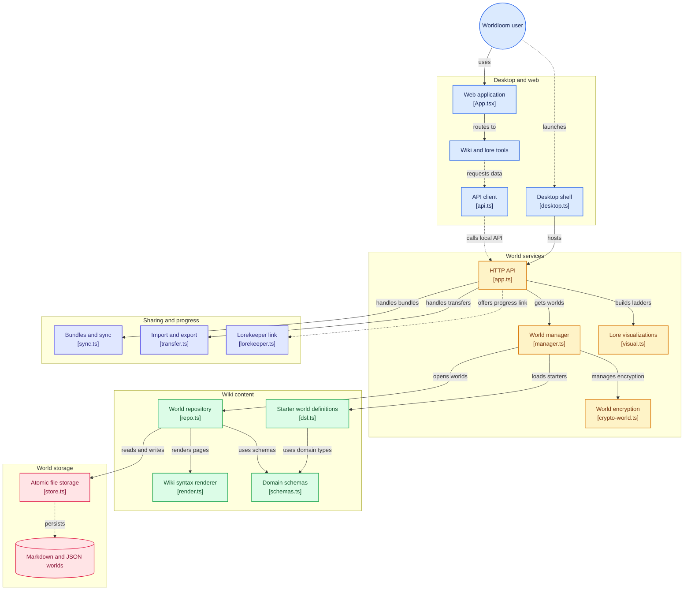

# Architecture

```
apps/desktop    Electron shell: main (window, menu, hardening) + preload (token bridge)
apps/web        React 18 + Vite + TS UI (TanStack Query, Zustand, CodeMirror 6, sigma.js)
packages/server Fastify API on 127.0.0.1 (ephemeral port, per-launch bearer token) + domain logic
packages/jsonstore  Standalone storage engine (extractable; atomic writes, mutex, watcher, migrations, backups)
packages/wikisyntax Markdown + wiki extensions: parse, render (sanitized), redact, link extract/rewrite
packages/shared Zod schemas/types, reveal evaluator, field coercion, APP_NAME
starter-worlds  Original demo worlds (TS definitions -> generated world folders) + type packs
e2e             Playwright tests that drive the built Electron app
```

## Runtime
1. `desktop.ts` takes the single-instance lock, resolves the data dir, starts the server in-process (`startServer`) on port 0 with a random 24-byte token, and serves the built UI **from the same origin** with a strict CSP header.
2. The preload asks the main process for `{baseUrl, token}` over sync IPC (answered only to our window) and exposes it with `contextBridge`. The renderer has no Node access (`sandbox`, `contextIsolation`, no `nodeIntegration`).
3. The UI talks to `/api/v1/...` with the bearer token. SSE (`/events`) pushes id-only change notifications; the UI coalesces them into refetches.

## Server
- `manager.ts` owns the data dir: worlds, settings, starter installs, backup import. One `WorldRepo` per world (in-flight opens are shared).
- `repo.ts` is the heart: pages as `.md` files ⇄ in-memory maps; name/alias/redirect resolution; incremental link index; MiniSearch (author index + per-viewer reader indexes updated incrementally); revisions; undo journals; health report; import/rename transactions.
- `visibility.ts` / `visual.ts` / `transfer.ts` apply the spoiler model to every read path (see SPOILERS.md). Every route declares a `mode` (`reader` default, `author` explicit).
- Storage: all writes go through `jsonstore` (tmp → fsync → rename, per-key mutex). Corrupt JSON is quarantined and restored from rolling backups; invalid hand edits are reported with file/line and never replace in-memory state.

## Frontend
Hash-routed SPA. World config (`useWorld`) is fetched with `mode=author` only on configuration screens; all content queries are keyed by mode/continuity so switching spoiler mode refetches from the server.

## Build / release
`scripts/build-desktop.mjs`: `vite build` → esbuild bundles main + preload (CJS) → copies renderer and starter worlds into `apps/desktop/dist`. `electron-builder` packages that (asar disabled so starter worlds copy as plain files). No native modules.

## Performance (tested in `packages/server/test/perf.test.ts`)
5,000 pages / 20,000 edges: open ≈ 1.8 s, author search ≈ 2 ms, reader search ≈ 20 ms, page view ≈ 1 ms, 5k-node graph query ≈ 30 ms; Electron cold start to first paint ≈ 1 s.


## Diagram


